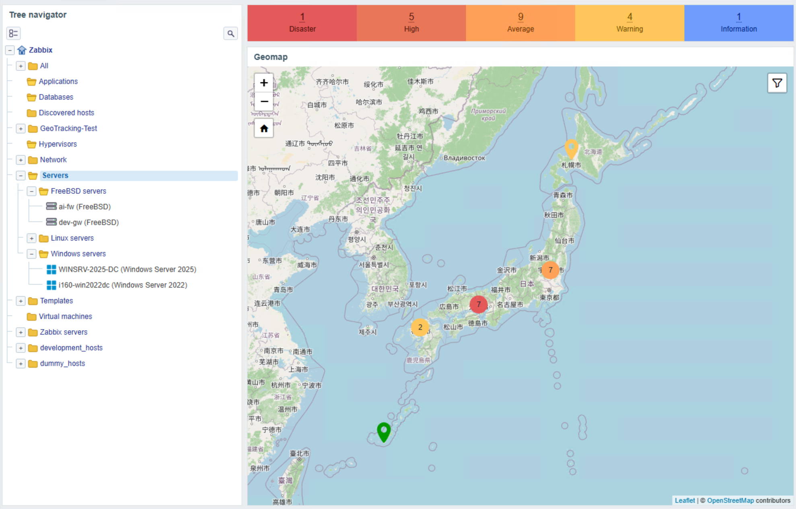
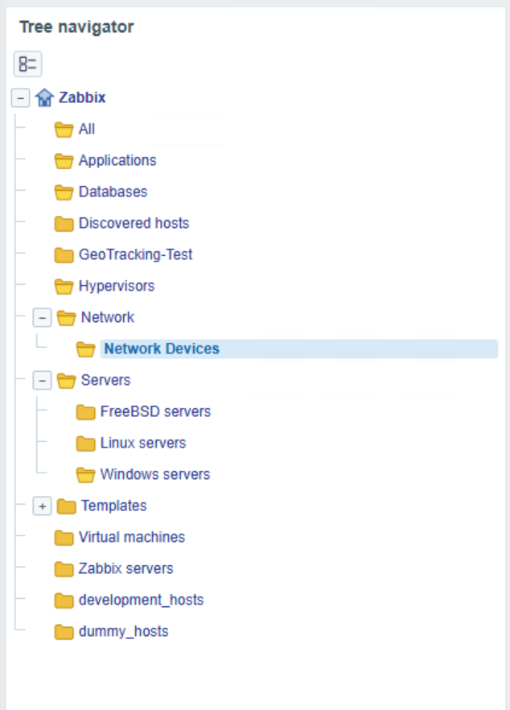
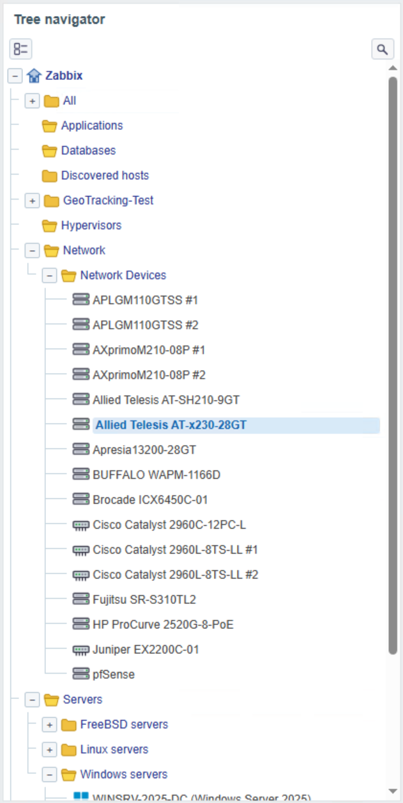
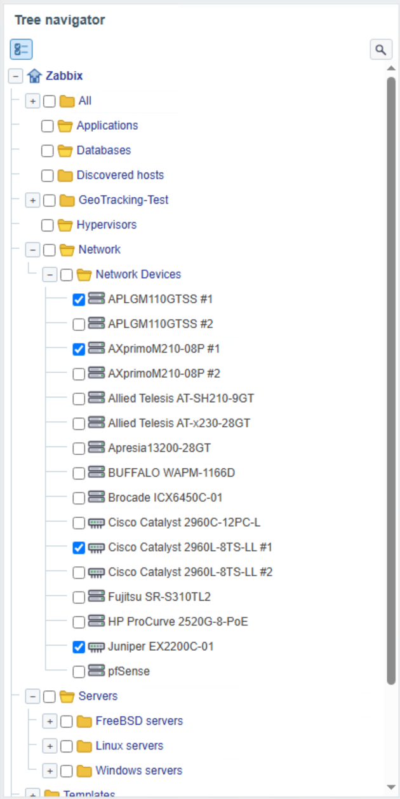
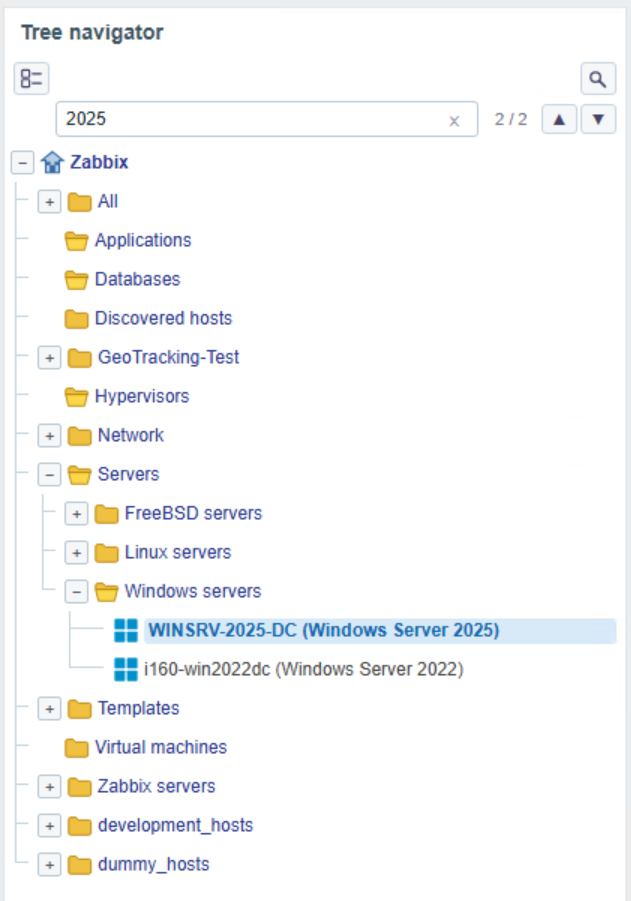
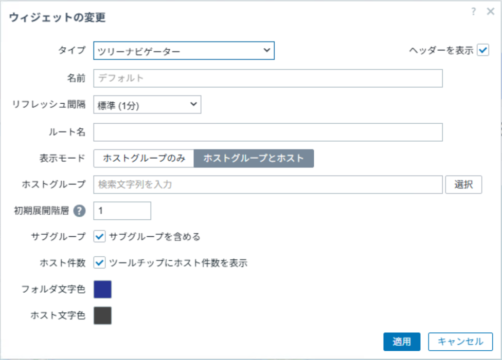

# zabbix-widget-tree-navigator

[English](README.md) | 日本語

## 概要

Tree Navigator は、Zabbix のホストグループとホストを折りたたみ可能なディレクトリツリー形式で表示するダッシュボードウィジェットです。

ダッシュボード上のナビゲーションとして利用でき、グループやホストを選択すると Zabbix ダッシュボードの動的パラメータを通じて連携先ウィジェットが更新されます。

マップ、状態サマリ、グラフ、その他のパネルをツリー選択に合わせて切り替えられます。



[最新リリース](https://github.com/HOLOZTEK/zabbix-widget-tree-navigator/releases/tag/v1.4.0) | [RPM](https://github.com/HOLOZTEK/zabbix-widget-tree-navigator/releases/download/v1.4.0/zabbix-widget-tree-navigator-1.4.0.noarch.rpm) | [DEB](https://github.com/HOLOZTEK/zabbix-widget-tree-navigator/releases/download/v1.4.0/zabbix-widget-tree-navigator_1.4.0_all.deb) | [Source](https://github.com/HOLOZTEK/zabbix-widget-tree-navigator/releases/download/v1.4.0/zabbix-widget-tree-navigator-1.4.0.tar.gz)

## 機能

<table>
  <tr>
    <th align="left" nowrap style="white-space: nowrap;">機能</th>
    <th align="left">説明</th>
  </tr>
  <tr>
    <td nowrap style="white-space: nowrap;">ツリー表示</td>
    <td>Zabbix のホストグループ階層を、折りたたみ可能なツリーとして表示します。</td>
  </tr>
  <tr>
    <td nowrap style="white-space: nowrap;">ホストグループ選択機能</td>
    <td>ホストグループの階層を選択し、連携先ウィジェットへグループ ID をブロードキャストします。</td>
  </tr>
  <tr>
    <td nowrap style="white-space: nowrap;">ホスト選択機能</td>
    <td>グループからホストまでたどり、ホストグループ ID またはホスト ID をブロードキャストします。</td>
  </tr>
  <tr>
    <td nowrap style="white-space: nowrap;">ホストメニュー呼び出し</td>
    <td>ホストのアイコンをクリックして、Zabbix 標準のホストクリック時メニューを表示できます。</td>
  </tr>
  <tr>
    <td nowrap style="white-space: nowrap;">複数選択機能</td>
    <td>複数のホストやグループをチェックし、選択内容をまとめて即時ブロードキャストします。</td>
  </tr>
  <tr>
    <td nowrap style="white-space: nowrap;">ホスト検索機能</td>
    <td>キーワードでホストを検索し、該当するツリーノードへ直接移動します。</td>
  </tr>
  <tr>
    <td nowrap style="white-space: nowrap;">ウィジェット連携</td>
    <td>Zabbix の動的パラメータを使って、マップ、状態サマリ、グラフ、その他のパネルを連動します。</td>
  </tr>
</table>

<table>
  <tr>
    <td align="center" valign="top" width="25%">
      <strong>ホストグループ選択機能</strong><br>
      
    </td>
    <td align="center" valign="top" width="25%">
      <strong>ホスト選択機能</strong><br>
      
    </td>
    <td align="center" valign="top" width="25%">
      <strong>複数選択機能</strong><br>
      
    </td>
    <td align="center" valign="top" width="25%">
      <strong>ホスト検索機能</strong><br>
      
    </td>
  </tr>
</table>

## 設定項目

<table>
  <tr bgcolor="#f0f3f5" style="background-color: #f0f3f5;">
    <th align="left">項目</th>
    <th align="left">説明</th>
  </tr>
  <tr>
    <td>ルート名</td>
    <td>ツリー最上位に表示するラベル</td>
  </tr>
  <tr>
    <td>表示モード</td>
    <td>ナビゲータの表示モードを切り替えます。</td>
  </tr>
  <tr>
    <td>ホストグループ</td>
    <td>ナビゲータの表示対象とするホストグループを指定します（複数指定も可能）。未指定では全てのホストグループが対象となります。</td>
  </tr>
  <tr>
    <td>初期展開階層</td>
    <td>初期展開する階層深さ（0〜10、デフォルト 1）</td>
  </tr>
  <tr>
    <td>サブグループを含める</td>
    <td>ホストグループで指定したグループの下位グループを再帰的に対象にします。</td>
  </tr>
  <tr>
    <td>ツールチップにホスト件数を表示</td>
    <td>ホストグループのアイコンにカーソルを合わせた際に、所属するホスト数を表示する機能を有効化します。</td>
  </tr>
  <tr>
    <td>フォルダ文字色</td>
    <td>ホストグループとルートラベルの文字色</td>
  </tr>
  <tr>
    <td>ホスト文字色</td>
    <td>ホストラベルの文字色</td>
  </tr>
</table>



## 出力（ブロードキャスト）

- 選択したホストグループ ID（単一）
- 選択したホストグループ ID（複数）
- 選択したホスト ID（単一）
- 選択したホスト ID（複数）

シングル選択時は、選択したグループ自身のIDに加え、`サブグループを含める` の設定に関わらず全階層ベースの子孫グループ ID を配信します（`サブグループを含める` は子孫ノードの自動展開という表示上の挙動のみを制御します）。

マルチ選択時は、チェックしたグループ自身の ID のみを配信します（子孫グループへの展開は行いません）。ホスト・グループのチェックボックスは混在可能で、チェック状態の変更ごとに即時ブロードキャストされます。

ホスト ID は、標準の Host navigator ウィジェット等との互換性のため、単一・複数どちらの出力にも同じ選択内容（シングル選択時は選択した1件、マルチ選択時はチェックした全件）を配信します。

## 動作要件

- Zabbix 7.0 以上
- PHP 8.0 以上

## インストール

### RPM からインストール

1. RPM をダウンロードし、Zabbix サーバーにインストール
   ```bash
   rpm -Uvh zabbix-widget-tree-navigator-1.4.0.noarch.rpm
   ```
2. パッケージにより、ウィジェットファイルは有効な Zabbix フロントエンドのモジュールディレクトリへ自動配置されます。
3. Zabbix 管理画面 -> 管理 -> モジュール からモジュールを有効化
4. ダッシュボードにウィジェットを追加

### DEB からインストール

1. DEB をダウンロードし、Zabbix サーバーにインストール
   ```bash
   apt install ./zabbix-widget-tree-navigator_1.4.0_all.deb
   ```
2. パッケージにより、ウィジェットファイルは有効な Zabbix フロントエンドのモジュールディレクトリへ自動配置されます。
3. Zabbix 管理画面 -> 管理 -> モジュール からモジュールを有効化
4. ダッシュボードにウィジェットを追加

### ソースから配置

1. このリポジトリを `tree-navigator` として Zabbix フロントエンドのモジュールディレクトリへ配置
   ```bash
   cp -a zabbix-widget-tree-navigator /usr/share/zabbix/ui/modules/tree-navigator
   ```
   Zabbix 環境が従来のモジュールパスを使用している場合は、代わりに `/usr/share/zabbix/modules/tree-navigator` へ配置してください。
2. ファイル所有者と権限を Zabbix フロントエンドから読み取れる状態に設定
3. Zabbix 管理画面 -> 管理 -> モジュール からモジュールを有効化
4. ダッシュボードにウィジェットを追加

## ドキュメント

- [CHANGELOG](docs/CHANGELOG.md)
- [CONTRIBUTING](docs/CONTRIBUTING.md)
- [SECURITY](docs/SECURITY.md)
- [Screenshot Guide](docs/screenshot-guide.md)
- [LICENSE](LICENSE)

## 構成

Zabbix モジュールとして読み込まれるファイルはリポジトリ直下と `actions/`, `assets/`, `includes/`, `views/` に配置しています。公開・運用向けの補助文書は `docs/` にまとめています。

## バージョン

最新バージョン: **v1.4.0**

## ライセンス

このプロジェクトは MIT License で公開されています。詳細は [LICENSE](LICENSE) を参照してください。
