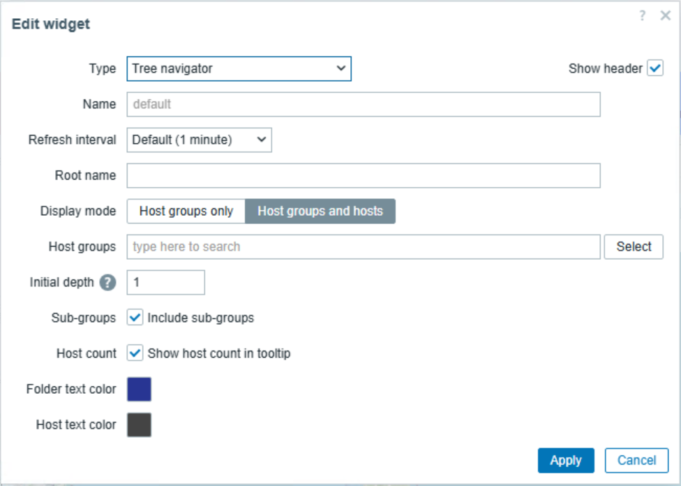

# zabbix-widget-tree-navigator

Zabbix ダッシュボードウィジェット — ホストグループとホストを折りたたみ可能なディレクトリツリー形式で表示し、選択したグループ・ホストを他のウィジェットへブロードキャストするナビゲーターです。

## Preview




## 機能

- ホストグループとホストをツリー構造で一覧表示
- ノードのクリックでグループ ID / ホスト ID を他のウィジェットへ配信（ブロードキャスト）
- 表示モード切替：ホストグループのみ / ホストグループ＋ホスト
- ルート名・初期展開深さ・対象グループを設定可能
- 下位グループを再帰的に含めるオプション
- ホバーツールチップにホスト数を表示するオプション
- キーワード検索による候補表示と該当ホストへのジャンプ
- シングル / マルチ選択切替（ツールバーのトグルボタン）。マルチ選択時はホスト・ホスト
  グループのアイコン左側にチェックボックスが表示され、チェックしたホスト・グループの
  ID を都度即時ブロードキャスト（ホスト・グループの混在チェック可、親子連動なし）
- 日本語 / 英語対応

## 設定項目

| 項目 | 説明 |
|------|------|
| Root name | ツリー最上位に表示するラベル |
| Display mode | ホストグループのみ / ホストグループ＋ホスト |
| Host groups | 表示対象グループを絞り込む（未指定で全グループ） |
| Initial depth | 初期展開する階層深さ（0〜10、デフォルト 1） |
| Include sub-groups | 下位グループを再帰的に含める |
| Show host count in tooltip | ホバー時にホスト数を表示 |

## 出力（ブロードキャスト）

- 選択したホストグループ ID（単一）
- 選択したホストグループ ID（複数）
- 選択したホスト ID（単一）
- 選択したホスト ID（複数）

シングル選択時は、選択したグループ自身のIDに加え、`Include sub-groups` の設定に関わらず
全階層ベースの子孫グループ ID を配信します（`Include sub-groups` は子孫ノードの自動展開
という表示上の挙動のみを制御します）。

マルチ選択時は、チェックしたグループ自身の ID のみを配信します（子孫グループへの展開は
行いません）。ホスト・グループのチェックボックスは混在可能で、チェック状態の変更ごとに
即時ブロードキャストされます。

ホスト ID は、標準の Host navigator ウィジェット等との互換性のため、単一・複数どちらの
出力にも同じ選択内容（シングル選択時は選択した1件、マルチ選択時はチェックした全件）を
配信します。

## 動作要件

- Zabbix 7.0 以上
- PHP 8.0 以上

## インストール

### RPM からインストール

1. RPM をダウンロードし、Zabbix サーバーにインストール
   ```
   rpm -Uvh zabbix-widget-tree-navigator-*.rpm
   ```
2. Zabbix 管理画面 → 管理 → モジュール からモジュールを有効化
3. ダッシュボードにウィジェットを追加

### ソースから配置

1. このリポジトリの内容を Zabbix フロントエンドのモジュールディレクトリへ配置
   ```
   /usr/share/zabbix/modules/tree-navigator
   ```
2. ファイル所有者と権限を Zabbix フロントエンドから読み取れる状態に設定
3. Zabbix 管理画面 → 管理 → モジュール からモジュールを有効化

## ドキュメント

- [CHANGELOG](docs/CHANGELOG.md)
- [CONTRIBUTING](docs/CONTRIBUTING.md)
- [SECURITY](docs/SECURITY.md)
- [Screenshot Guide](docs/screenshot-guide.md)
- [LICENSE](LICENSE)

## 構成

Zabbix モジュールとして読み込まれるファイルはリポジトリ直下と `actions/`, `assets/`,
`includes/`, `views/` に配置しています。公開・運用向けの補助文書は `docs/` にまとめています。

## バージョン

最新バージョン: **v1.3.1**

## ライセンス

This project is licensed under the MIT License. See [LICENSE](LICENSE) for details.
